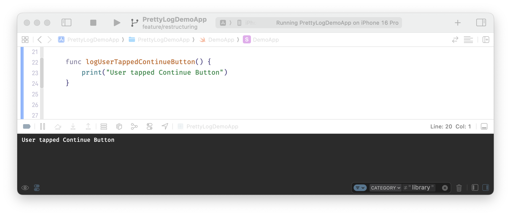
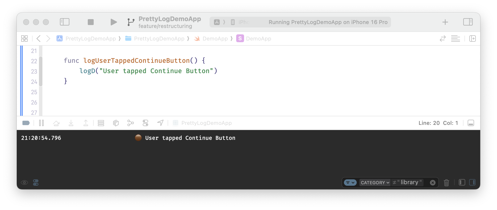
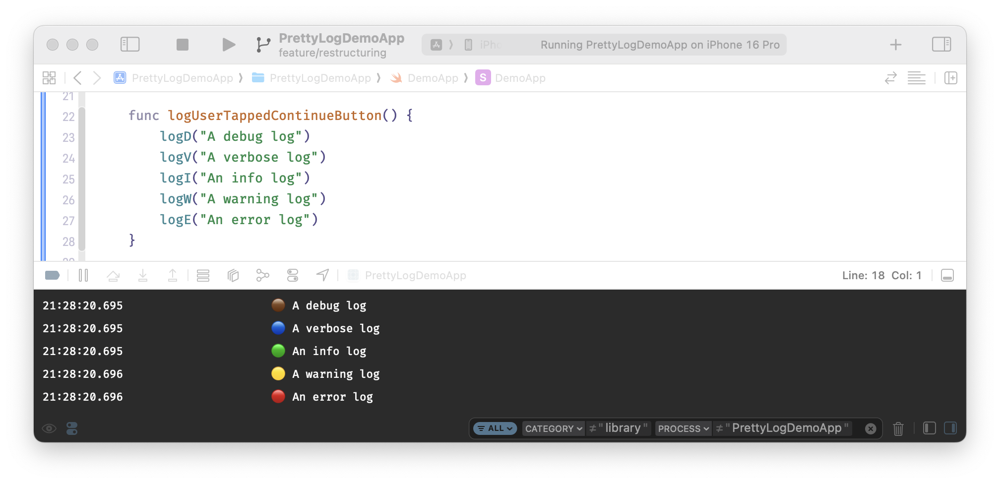
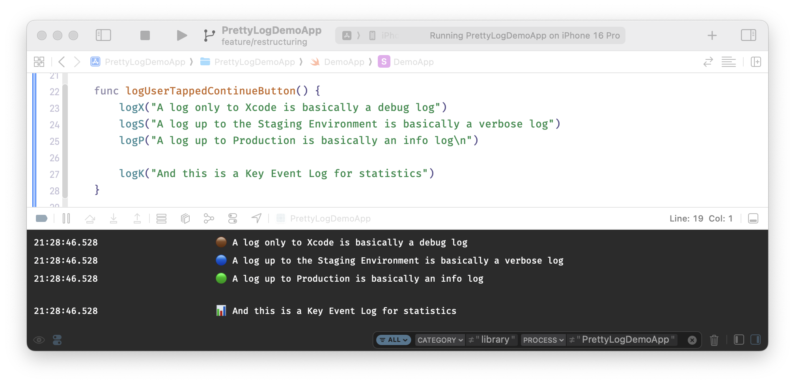
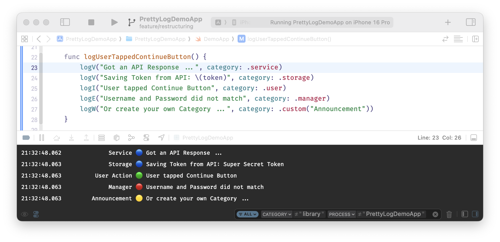
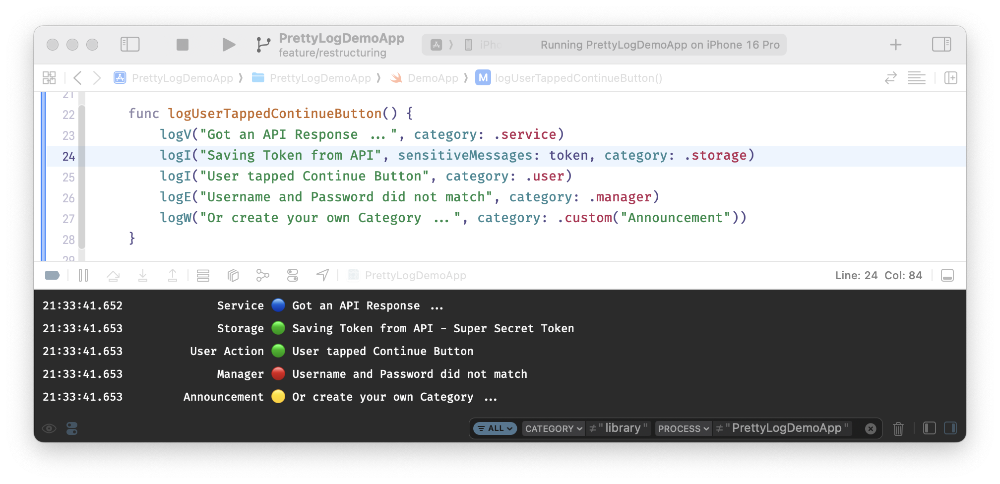
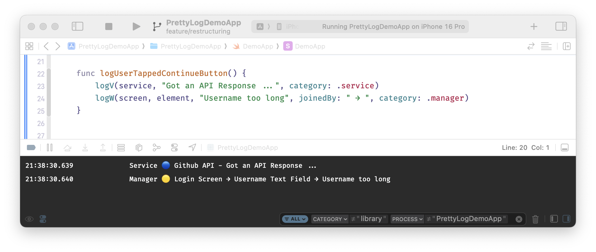
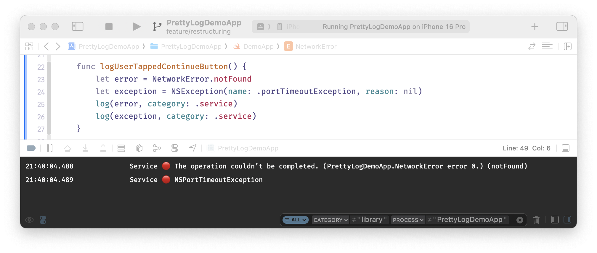

<h1 align="center">Welcome to PrettyLog 👋</h1>
<p align="center">
  <a href="https://swiftpackageindex.com/bennokress/PrettyLog" target="_blank">
    
  </a>
  <a href="https://github.com/bennokress/PrettyLog/blob/main/LICENSE" target="_blank">
    
  </a>
</p>

> PrettyLog is a small Swift Package that makes logging in the Xcode Console a little bit more beautiful.

## Installation

```sh
dependencies: [
    .package(url: "https://github.com/bennokress/PrettyLog", .upToNextMajor(from: "2.0.0"))
]
```

## Requirements

- Xcode 26 / Swift 6.2 toolchain or later (`swift-tools-version: 6.2`)
- iOS 16, Mac Catalyst 16, macOS 13, tvOS 16 or watchOS 9 as deployment target

PrettyLog declares your log levels with a Swift macro, so it depends on [swift-syntax](https://github.com/swiftlang/swift-syntax). The first time Xcode builds it in your project, it asks you to trust and enable the macro `PrettyLogMacros`.

## Migrating from an earlier version

Every major version comes with migration notes that list what changed and what you have to do:

- [PrettyLog 1 → 2](Migration%20Notes/v1-to-v2.md)
- [PrettyLog 2 → 3](Migration%20Notes/v2-to-v3.md)

## Setup

PrettyLog ships no log target, no log levels, no log categories and no global log functions. Your app decides where its log statements go, which of those destinations may receive sensitive data, which levels it needs and how it titles its statements, so it defines all four once.

Every declaration in the samples below is marked `nonisolated`. New Xcode projects make the main actor the default isolation of an app (`SWIFT_DEFAULT_ACTOR_ISOLATION = MainActor`). Without the keyword, your targets, levels, categories and log functions would belong to the main actor too, and logging from a background task, an actor or a `nonisolated` function would fail with errors like these:

- `Main actor-isolated global function 'logI(_:sensitiveMessages:joinedBy:category:)' cannot be called from outside of the actor`
- `Main actor-isolated conformance of 'ConsoleLog' to 'LogTarget' cannot be used in nonisolated context`
- `Main actor-isolated static property 'todo' can not be referenced from a nonisolated context`

In a project without that setting the keyword changes nothing, so keep it either way.

### 1. Define your log levels

Your log levels are an enum with `@LogLevels`. Each case is one level: `@Emoji` gives it its emoji, and the `Int` raw value is its priority. Targets filter by priority, and levels are ordered by priority, so the order of the cases means nothing and you can sort them alphabetically. The compiler rejects two levels with the same priority. This set is a good start:

```swift
import PrettyLog

@LogLevels
nonisolated enum AppLogLevel: Int {

    @Emoji("🟤") case debug = 100
    @Emoji("🔴") case error = 900
    @Emoji("🟢") case info = 500
    @Emoji("📊") case keyEvent = 1000
    @Emoji("🔵") case verbose = 300
    @Emoji("🟡") case warning = 700

}
```

`@LogLevels` adds `emoji`, `allCases` and the conformance to `LogLevel`, so the enum declares nothing but its cases. Always declare your levels this way and never conform to `LogLevel` by hand. A raw value has to be a literal, which is why the highest level gets a number well above the others instead of `Int.max`.

The names are yours, the name of the enum as well. If you would rather name the lower levels after where a statement should end up, see <a href="#semantic-log-levels">'Semantic Log Levels'</a>.

### 2. Define a log target

A log target conforms to `LogTarget` and decides how a log statement looks and where it goes. This one prints to the Xcode console and only includes sensitive messages in debug builds:

```swift
import Foundation
import PrettyLog

nonisolated struct ConsoleLog: LogTarget {

    var canLogSensitiveInformation: Bool { isDebugApp }

    func emit(_ level: AppLogLevel, message: String, category: LogCategory) {
        print("\(prefix(level: level, category: category)) \(message)")
    }

    // MARK: Private Helpers

    private var isDebugApp: Bool {
        #if DEBUG
        return true
        #else
        return false
        #endif
    }

    private var currentTimestamp: String {
        let formatter = DateFormatter()
        formatter.dateFormat = "HH:mm:ss.SSS"
        return formatter.string(from: Date())
    }

    private func prefix(level: AppLogLevel, category: LogCategory) -> String {
        "\(currentTimestamp) \(category.name.truncatedOrPadded(to: 20)) \(level.emoji)"
    }

}

nonisolated extension String {

    /// The String cut or padded to exactly the given length, so the categories of all log statements line up.
    /// A longer String ends in "…", a shorter one is padded with spaces at the beginning.
    func truncatedOrPadded(to length: Int) -> String {
        guard length > 0 else { return "" }
        guard count <= length else { return String(prefix(length - 1)) + "…" }
        return String(repeating: " ", count: length - count) + self
    }

}
```

`LogTarget` has three requirements:

- `canLogSensitiveInformation`: if `false`, the target never receives the sensitive part of a log statement.
- `emit(_:message:category:)`: gives the log statement its form and passes it on to its destination.
- `levelFilter`: the levels the target accepts, for example `.from(.info)` or `.only(.keyEvent)` (see <a href="#filtering-log-levels">'Filtering Log Levels'</a>). It is optional and accepts every level by default.

A target names the level type of your app in `emit(_:message:category:)`. Because your levels are an enum, a target that maps them to something else, for example to an `OSLogType`, can `switch` over them without a `default` branch: a level you add later doesn't compile until every such target handles it. A target that only uses what every level has, like the emoji and the priority, can also stay generic and be shared between apps with different levels: `struct ConsoleLog<Level: LogLevel>: LogTarget` with `func emit(_ level: Level, …)`.

### 3. Define your log categories

A log category is a name that titles a log statement. The only one PrettyLog brings along is `.uncategorized`, the empty title of a statement without a category. This set is a good start:

```swift
import PrettyLog

nonisolated extension LogCategory {

    static var appState: LogCategory { LogCategory("App State") }
    static var debug: LogCategory { LogCategory("Debug") }
    static var general: LogCategory { LogCategory("General") }
    static var manager: LogCategory { LogCategory("Manager") }
    static var service: LogCategory { LogCategory("Service") }
    static var storage: LogCategory { LogCategory("Storage") }
    static var user: LogCategory { LogCategory("User Action") }
    static var view: LogCategory { LogCategory("View") }

}
```

### 4. Define your log functions

Create one Swift file in your app that imports PrettyLog, lists your targets and defines the global log functions you want to use. Every function hands its arguments on to `PrettyLogProxy`, because Swift can't forward variadic parameters from one function to another. With this file in place, no other file in your app needs to import PrettyLog.

```swift
import Foundation
import PrettyLog

/// Log a statement with DEBUG level.
/// - Parameters:
///   - messages: One or more strings and string-convertible objects to include in the log statement
///   - sensitiveMessages: One or more strings and string-convertible objects to include in the log statement if the target allows sensitive content
///   - separator: The separator between messages, also used between the public and the sensitive part (defaults to `" - "`)
///   - category: The category of the log message (defaults to `.uncategorized`)
/// - Attention: No log will be created, if `messages` and `sensitiveMessages` are both empty or consist only of `nil`-elements!
nonisolated func logD(_ messages: (any CustomStringConvertible)?..., sensitiveMessages: (any CustomStringConvertible)?..., joinedBy separator: String = " - ", category: LogCategory = .uncategorized) {
    PrettyLogProxy.log(messages, sensitiveMessages: sensitiveMessages, joinedBy: separator, as: .debug, category: category, to: logTargets)
}

/// Log a statement with VERBOSE level.
/// - Parameters:
///   - messages: One or more strings and string-convertible objects to include in the log statement
///   - sensitiveMessages: One or more strings and string-convertible objects to include in the log statement if the target allows sensitive content
///   - separator: The separator between messages, also used between the public and the sensitive part (defaults to `" - "`)
///   - category: The category of the log message (defaults to `.uncategorized`)
/// - Attention: No log will be created, if `messages` and `sensitiveMessages` are both empty or consist only of `nil`-elements!
nonisolated func logV(_ messages: (any CustomStringConvertible)?..., sensitiveMessages: (any CustomStringConvertible)?..., joinedBy separator: String = " - ", category: LogCategory = .uncategorized) {
    PrettyLogProxy.log(messages, sensitiveMessages: sensitiveMessages, joinedBy: separator, as: .verbose, category: category, to: logTargets)
}

/// Log a statement with INFO level.
/// - Parameters:
///   - messages: One or more strings and string-convertible objects to include in the log statement
///   - sensitiveMessages: One or more strings and string-convertible objects to include in the log statement if the target allows sensitive content
///   - separator: The separator between messages, also used between the public and the sensitive part (defaults to `" - "`)
///   - category: The category of the log message (defaults to `.uncategorized`)
/// - Attention: No log will be created, if `messages` and `sensitiveMessages` are both empty or consist only of `nil`-elements!
nonisolated func logI(_ messages: (any CustomStringConvertible)?..., sensitiveMessages: (any CustomStringConvertible)?..., joinedBy separator: String = " - ", category: LogCategory = .uncategorized) {
    PrettyLogProxy.log(messages, sensitiveMessages: sensitiveMessages, joinedBy: separator, as: .info, category: category, to: logTargets)
}

/// Log a statement with WARNING level.
/// - Parameters:
///   - messages: One or more strings and string-convertible objects to include in the log statement
///   - sensitiveMessages: One or more strings and string-convertible objects to include in the log statement if the target allows sensitive content
///   - separator: The separator between messages, also used between the public and the sensitive part (defaults to `" - "`)
///   - category: The category of the log message (defaults to `.uncategorized`)
/// - Attention: No log will be created, if `messages` and `sensitiveMessages` are both empty or consist only of `nil`-elements!
nonisolated func logW(_ messages: (any CustomStringConvertible)?..., sensitiveMessages: (any CustomStringConvertible)?..., joinedBy separator: String = " - ", category: LogCategory = .uncategorized) {
    PrettyLogProxy.log(messages, sensitiveMessages: sensitiveMessages, joinedBy: separator, as: .warning, category: category, to: logTargets)
}

/// Log a statement with ERROR level.
/// - Parameters:
///   - messages: One or more strings and string-convertible objects to include in the log statement
///   - sensitiveMessages: One or more strings and string-convertible objects to include in the log statement if the target allows sensitive content
///   - separator: The separator between messages, also used between the public and the sensitive part (defaults to `" - "`)
///   - category: The category of the log message (defaults to `.uncategorized`)
/// - Attention: No log will be created, if `messages` and `sensitiveMessages` are both empty or consist only of `nil`-elements!
nonisolated func logE(_ messages: (any CustomStringConvertible)?..., sensitiveMessages: (any CustomStringConvertible)?..., joinedBy separator: String = " - ", category: LogCategory = .uncategorized) {
    PrettyLogProxy.log(messages, sensitiveMessages: sensitiveMessages, joinedBy: separator, as: .error, category: category, to: logTargets)
}

/// Log a Key Event.
/// - Parameters:
///   - messages: One or more strings and string-convertible objects to include in the log statement
///   - separator: The separator between messages (defaults to `" - "`)
///   - category: The category of the log message (defaults to `.uncategorized`)
/// - Attention: No log will be created, if `messages` is empty or consist only of `nil`-elements!
nonisolated func logK(_ messages: (any CustomStringConvertible)?..., joinedBy separator: String = " - ", category: LogCategory = .uncategorized) {
    PrettyLogProxy.log(messages, joinedBy: separator, as: .keyEvent, category: category, to: logTargets)
}

/// Log an `Error`.
///
/// The public part is the `localizedDescription` of a `LocalizedError` or an `NSError`, and the name of the type for any other error,
/// because Foundation would only produce "The operation couldn't be completed." for it. The full description goes into the sensitive part,
/// because it can contain the `userInfo` of an `NSError`, a complete URL or the associated values of an error enum.
/// - Parameters:
///   - error: The error to log
///   - category: The category of the log message (defaults to `.uncategorized`)
/// - Attention: No log will be created, if `error` is `nil`.
nonisolated func log(_ error: Error?, category: LogCategory = .uncategorized) {
    guard let error else { return }
    let isReadable = error is LocalizedError || type(of: error) is NSError.Type
    let publicPart = isReadable ? error.localizedDescription : String(describing: type(of: error))
    PrettyLogProxy.log([publicPart], sensitiveMessages: ["\(error)"], as: .error, category: category, to: logTargets)
}

// TODO: Add a log function for every other level you define -> for example `logT` for a level `.todo` (see "Custom Log Levels").

// MARK: - Log Targets

/// Every log statement is sent to these targets. Add your own, for example one that sends statements to your backend.
nonisolated private var logTargets: [any LogTarget<AppLogLevel>] {
    [ConsoleLog()]
}
```

## Basic Usage

With the setup in place you can make your print statements prettier and more useful. Just replace this ...

```swift
print("User tapped Continue Button")
```



... with this:

```swift
logD("User tapped Continue Button")
```



So far so good. You have a lot more options with PrettyLog though ...

## Advanced Usage

All samples below call the log functions from your own file (see <a href="#setup">'Setup'</a>).

### Log Levels

```swift
logD("A debug log")
logV("A verbose log")
logI("An info log")
logW("A warning log")
logE("An error log")
```



### Semantic Log Levels

If your app has a staging environment, you may prefer to name the lower levels after where a statement should end up: Xcode, Staging and Production instead of Debug, Verbose and Info. Declare them with the same values in place of `debug`, `verbose` and `info`:

```swift
@LogLevels
nonisolated enum AppLogLevel: Int {

    @Emoji("🔴") case error = 900
    @Emoji("📊") case keyEvent = 1000
    @Emoji("🟢") case production = 500
    @Emoji("🔵") case staging = 300
    @Emoji("🟡") case warning = 700
    @Emoji("🟤") case xcode = 100

}
```

Then name the log functions `logX`, `logS` and `logP`, passing `as: .xcode`, `as: .staging` and `as: .production`:

```swift
logX("A log only to Xcode")
logS("A log up to the Staging Environment")
logP("A log up to Production")
```

The Key Event from the setup is for statistics. It has the highest priority, so every target that filters by a minimum level receives it:

```swift
logK("And this is a Key Event Log for statistics")
```



### Log Categories

```swift
logV("Got an API Response ...", category: .service)
logV("Saving Token from API: \(token)", category: .storage)
logI("User tapped Continue Button", category: .user)
logE("Username and Password did not match", category: .manager)
logW("Or create a Category on the spot ...", category: LogCategory("Announcement"))
```



### Sensitive Data Logging

But wouldn't it be nice to log that a token was saved in production, but omit the token itself there while still logging it in development? Pass it as a sensitive message. Only targets whose `canLogSensitiveInformation` is `true` receive it:

```swift
logV("Got an API Response ...", category: .service)
logI("Saving Token from API", sensitiveMessages: token, category: .storage)
logI("User tapped Continue Button", category: .user)
logE("Username and Password did not match", category: .manager)
logW("Or create a Category on the spot ...", category: LogCategory("Announcement"))
```

The sensitive part is appended to the public part with the same separator as the messages.



### Log Message Concatenation

```swift
logV(service, "Got an API Response ...", category: .service)
logW(screen, element, "Username too long", joinedBy: " → ", category: .manager)
```

Messages don't have to be strings. Anything that conforms to `CustomStringConvertible` is written as its `description`, and `nil` is left out:

```swift
logD("Loaded items:", items.count, "from", url)
```



### Errors

PrettyLog has no method of its own for errors. The `log(_:category:)` function from the setup file logs the readable part of an error for every target and its full description only for targets that may receive sensitive data:

```swift
let error = NetworkError.notFound
log(error, category: .service)
```



## Expert Usage

### Custom Log Categories

The categories from the setup are only a suggestion. Add any category you need to the same extension:

```swift
nonisolated extension LogCategory {

    /// This category can be used like all the others: logV("Running Unit Tests ...", category: .todo)
    static var todo: LogCategory { LogCategory("To Do") }

}
```

A target can compare categories with `==`, for example to send only `.storage` statements to a separate file.

### Custom Log Levels

The levels from the setup are only a suggestion. Add any level you need as a case of your enum, with its own emoji and a priority that sorts it between the others:

```swift
@LogLevels
nonisolated enum AppLogLevel: Int {

    // …
    /// Sorts between `debug` and `verbose`.
    @Emoji("🟣") case todo = 200
    // …

}
```

Every target that switches over your levels has to handle the new case before your app compiles again.

To use it like the other levels, define a global method like `logT` for it in your logging file (see <a href="#setup">'Setup'</a>):

```swift
/// Log messages in the provided order with TODO level
/// - Parameters:
///     - messages: One or more strings and string-convertible objects to include in the log statement
///     - sensitiveMessages: One or more strings and string-convertible objects to include in the log statement if the target allows sensitive content
///     - separator: The separator between messages, also used between the public and the sensitive part (defaults to `" - "`)
/// - Attention: No log will be created, if `messages` and `sensitiveMessages` are both empty or consist only of `nil`-elements.
nonisolated func logT(_ messages: (any CustomStringConvertible)?..., sensitiveMessages: (any CustomStringConvertible)?..., joinedBy separator: String = " - ") {
    PrettyLogProxy.log(messages, sensitiveMessages: sensitiveMessages, joinedBy: separator, as: .todo, category: .todo, to: logTargets)
}
```

### More Log Targets

In real world apps you might want to log to backends and web services as well, or locally with something other than `print`. Each destination is its own `LogTarget`, and your logging file sends every statement to all of them. A target for a backend would typically reject sensitive data and only accept the more important levels:

```swift
import Foundation
import PrettyLog

nonisolated struct BackendLog: LogTarget {

    let canLogSensitiveInformation = false

    var levelFilter: LogLevelPriorityFilter<AppLogLevel> { .from(.info) }

    func emit(_ level: AppLogLevel, message: String, category: LogCategory) {
        // Send the statement to your backend
    }

}
```

Then add it to the list in your logging file:

```swift
nonisolated private var logTargets: [any LogTarget<AppLogLevel>] {
    [ConsoleLog(), BackendLog()]
}
```

### Filtering Log Levels

A target's `levelFilter` decides which levels reach it. It compares priorities, never the order of your cases:

| Filter | Accepts |
| --- | --- |
| `.all` | every level, the default |
| `.none` | no level, for example until the user agrees to send logs to a server |
| `.only(.keyEvent, .error)` | exactly the given levels |
| `.from(.info)` | the given level and every level with a higher priority |
| `.until(.warning)` | the given level and every level with a lower priority |
| `.between(.verbose, and: .warning)` | every level with a priority between the two, both included, in either order |

Two filters are equal when they accept the same levels, so `.only(.info)` equals `.between(.info, and: .info)`.

### Keeping Targets in a Constant

`LogTarget` doesn't require `Sendable`, so a target can be any type, including a class with mutable state. The computed `logTargets` above creates the targets on every call and works with any of them. If you would rather create them once and keep them in a constant, the Swift 6 language mode requires the constant to be `Sendable`. Make your target types `Sendable` and declare the list like this:

```swift
nonisolated private let logTargets: [any LogTarget<AppLogLevel> & Sendable] = [ConsoleLog(), BackendLog()]
```

Structs whose stored properties are all `Sendable` get the conformance automatically, as long as they aren't `public`. A class needs to be `final` and protect its mutable state itself, for example with a lock.

## Author

👨🏻‍💻 **Benno Kress**

-   Website: [bennokress.de](https://bennokress.de)
-   Mastodon: [@benno@iosdev.space](https://iosdev.space/@benno)

## 🤝 Contributing

Contributions, issues and feature requests are welcome!<br />Feel free to check [issues page](https://github.com/bennokress/PrettyLog/issues?q=is%3Aissue+is%3Aopen+sort%3Aupdated-desc).

## 📝 License

Copyright © [Benno Kress](https://github.com/bennokress).<br />
This project is [MIT](https://github.com/bennokress/PrettyLog/blob/main/LICENSE) licensed.

---

_This README was generated with ❤️ by [readme-md-generator](https://github.com/kefranabg/readme-md-generator)_
